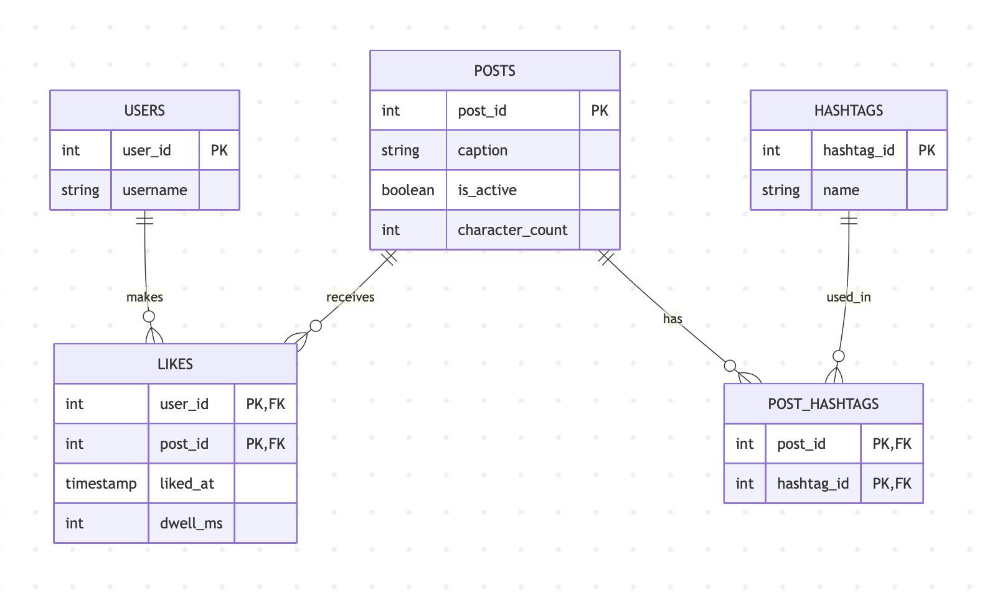

# Social Media Database (EX603)

**By Jan Lemar Baltazar**

**Theme:** Social Media

## Project Overview

This project models a social media platform using a relational database. The goal is to explore how SQL can be used to analyze user activity, post engagement, and reaction removals.

Throughout the project, I used SQL queries to investigate engagement patterns, identify posts with higher removal rates, and examine how activity changes over time. I also explored different SQL techniques, including joins, aggregate functions, CTEs, and window functions.

## Schema

This project models a social media platform using five relations:

- `users` — stores the users of the social media platform.
- `posts` — stores the posts created on the platform.
- `likes` — records which users like which posts, along with the time of the like and dwell time.
- `hashtags` — stores the hashtags used by posts.
- `post_hashtags` — connects posts and hashtags through a many-to-many relationship.

The `likes` and `post_hashtags` tables use composite primary keys to prevent any duplicate relationships. The foreign keys use `ON DELETE CASCADE` so any likes and hashtag associations are removed when their referenced records are deleted (like deleting a user/post/hashtag). The schema also uses CHECK constraints to avoid any negative character counts and negative dwell times.

The project began with an original five-table database design. As the assignments progressed, I expanded the database to support additional analysis of reaction activity, engagement, and content moderation.

The original database definition is available in [`schema/schema.sql`](schema/schema.sql), while the entity relationships are illustrated in the [ERD](schema/erd.png).

### Entity Relationship Diagram

- [Schema definition](schema/schema-definition.md)
- [Constraints](schema/constraints.md)
- [Database creation script](schema/schema.sql)

## Query Catalogue

### Unit 1: Modeling the Platform
- [Unit 1 analysis](analysis/unit1.md)

### Unit 2: From Diagram to Database
- [Unit 2 analysis](analysis/unit2.md)

### Unit 3: Interrogating the Data
- [Task 3.1](queries/unit3/q3_1.sql)
- [Task 3.2](queries/unit3/q3_2.sql)
- [Task 3.3](queries/unit3/q3_3.sql)
- [Unit 3 findings](analysis/unit3-finding.md)

### Unit 4: From Rows to Insight
- [Task 4.1](queries/unit4/q4_1.sql)
- [Task 4.2](queries/unit4/q4_2.sql)
- [Unit 4 analysis](analysis/unit4.md)
- [Unit 4 findings](analysis/unit4-finding.md)

### Unit 5: Connecting the Tables
- [Task 5.1](queries/unit5/q5_1.sql)
- [Task 5.2](queries/unit5/q5_2.sql)
- [Task 5.3](queries/unit5/q5_3.sql)
- [Unit 5 analysis](analysis/unit5.md)
- [Unit 5 findings](analysis/unit5-finding.md)

### Unit 6: Analytics & Portfolio
- [Task 6.1](queries/unit6/q6_1.sql)
- [Task 6.2](queries/unit6/q6_2.sql)
- [Task 6.3](queries/unit6/q6_3.sql)
- [Unit 6 analysis](analysis/unit6.md)
- [Unit 6 closing memo](analysis/unit6-finding.md)

## Technical Highlights

- **Relational database design:** I used primary keys, foreign keys, and composite keys to organize relationships and maintain data integrity.
- **Aggregate functions:** I also used COUNT, AVG, SUM, and conditional aggregation to summarize reaction activity.
- **Joins:** I combined information across related tables and organized more complex queries into readable steps.

## Key Findings and Recommendations

The database contained 200 reaction events:

- 156 active reactions.
- 10 flagged reactions.
- 34 removed reactions.
- Overall removal rate of 17%.

Post-level analysis identified Post 11 with a 31.25% removal rate and Post 9 with a 28.57% removal rate.

Based on these findings, I recommend reviewing the removal reasons for Posts 11 and 9 to understand why they have higher removal rates. I also recommend creating a monthly report that tracks active, flagged, and removed reactions separately.

The monthly analysis found activity across all 12 months, but it did not track monthly removal rates. Therefore, the results I have right now can't exactly determine whether the removal problem is improving or getting worse.

## Limitations and Future Improvements

I think a limitation of this project is that the monthly analysis tracks total reaction events rather than changes in reaction status. This makes it difficult to determine whether reaction removals are increasing or decreasing over time.

Future improvements could include tracking removal rates by month, investigating removal reasons for individual posts, and expanding the analysis to identify patterns in flagged and removed reactions.

## Screenshots

Query results and project evidence are available in the [screenshots folder](screenshots/).

## Project Presentation

**Video Presentation:** [Insert video URL here]

## Running the Project

1. Clone or download this repository.
2. Open the project in your SQL environment.
3. Connect to a PostgreSQL database.
4. Run `schema/schema.sql` to create the database tables.
5. Execute the SQL query files from the `queries` directory.
6. Review the written analysis and findings in the `analysis` directory.

**Database:** PostgreSQL

**Schema file:** `schema/schema.sql`